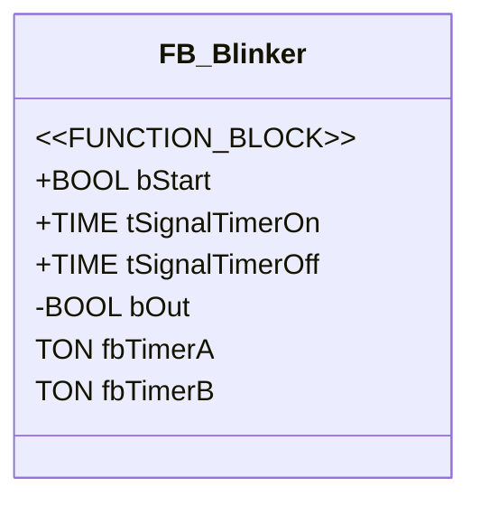
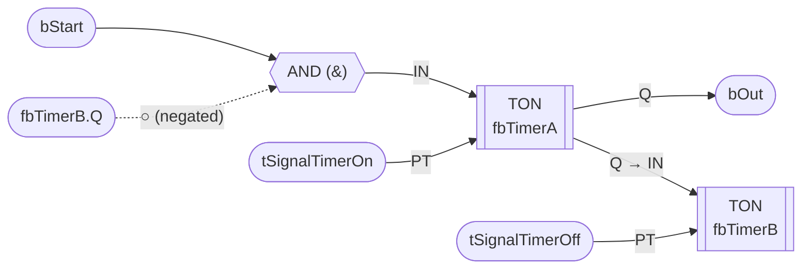

# FB_Blinker

> **POU Type:** FUNCTION_BLOCK  
> **Source:** `FB_Blinker.TcPOU`  
> **Implementation Language:** FBD (Function Block Diagram)

## Declaration

## Implementation (FBD) — Network 1

### Logic Description

A self-resetting blinker oscillator:

1. `bStart` AND `NOT fbTimerB.Q` feed into the **AND** gate
2. AND output → `fbTimerA.IN`, `tSignalTimerOn` → `fbTimerA.PT`
3. `fbTimerA.Q` drives `bOut` (the blinking output) **and** feeds forward to `fbTimerB.IN`
4. `tSignalTimerOff` → `fbTimerB.PT`
5. When `fbTimerB` times out, its `.Q` goes HIGH, which negates the AND input → resets `fbTimerA` → cycle restarts
