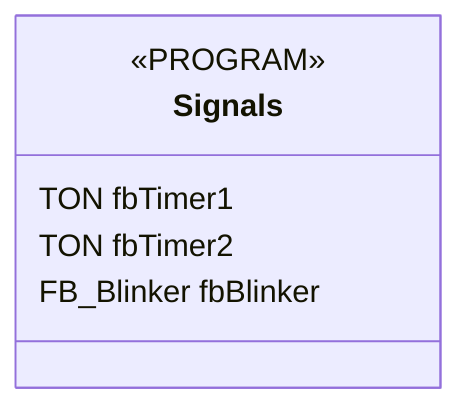
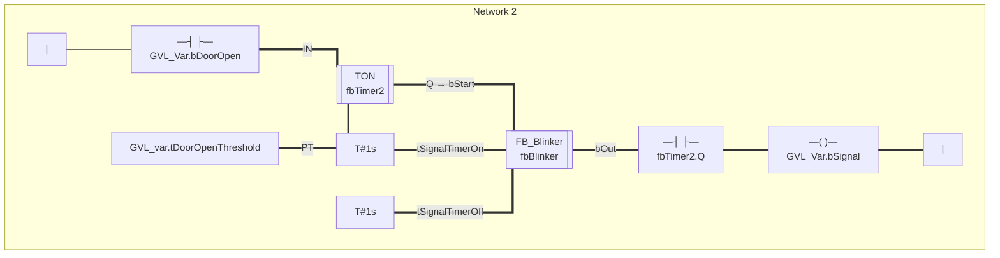
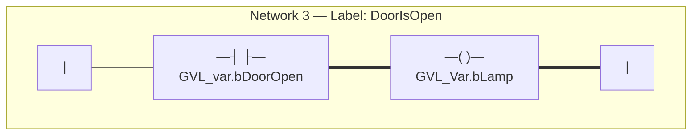

# Signals

> **POU Type:** PROGRAM  
> **Source:** `Signals.TcPOU`  
> **Implementation Language:** LD (Ladder Diagram) via NWL

## Declaration

## Implementation (LD) — Network 1

```mermaid
%%{ init: { 'flowchart': { 'curve': 'stepAfter' } } }%%
flowchart LR
    subgraph Network_1 [" Network 1 "]
        direction LR
        %% --- Power Rails ---
        N1_L["|"]
        N1_R["|"]

        %% --- Contacts ---
        N1_bCompressor["—┤ ├—<br/>GVL_VAR.bCompressor"]
        N1_tImAlarmThreshold["GVL_Var.tImAlarmThreshold"]

        %% --- Function Blocks ---
        N1_TON[["TON<br/>fbTimer1"]]

        %% --- Bifurcation Junctions ---
        J_N1_TON_Q(( )):::junction

        %% --- Coils / Jumps ---
        N1_bSignal["—( )—<br/>GVL_Var.bSignal"]
        N1_DoorIsOpen["▶ DoorIsOpen"]

        %% --- Continuity ---
        N1_L --- N1_bCompressor
        N1_bCompressor ===|"IN"| N1_TON
        N1_tImAlarmThreshold ===|"PT"| N1_TON
        N1_TON ===|"Q"| J_N1_TON_Q
        J_N1_TON_Q === N1_bSignal
        J_N1_TON_Q === N1_DoorIsOpen
        N1_bSignal === N1_R

        classDef junction fill:#333,stroke:#333,width:6px,height:6px
    end
```

## Implementation (LD) — Network 2

## Implementation (LD) — Network 3 (Label: DoorIsOpen)

