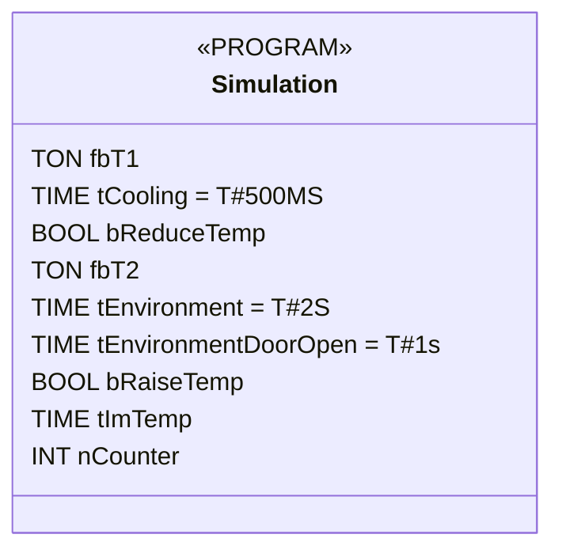

# Simulation

> **POU Type:** PROGRAM  
> **Source:** `Simulation.TcPOU`  
> **Implementation Language:** ST (Structured Text) — *flowchart not generated*

## Declaration



## Implementation (ST)

> [!NOTE]
> This POU uses Structured Text. No flowchart diagram is generated — the source code is shown below.

```iecst
// After the compressor has been activated due to fTempActual being too high, the temperature decreases.
// The temperature is decremented by 0.1°C per cycle after a delay of P_Cooling
IF GVL_VAR.bCompressor THEN
    fbT1(IN:= GVL_Var.bCompressor, PT:= tCooling, Q=>bReduceTemp);
    IF bReduceTemp THEN
        GVL_Var.fTempActual := GVL_Var.fTempActual-0.1;
        fbT1(IN:=FALSE);
    END_IF
END_IF

//If the door is open, the warming will occur faster; SEL selects tEnvironmentDoorOpen
tImTemp:=SEL(GVL_Var.bDoorOpen, tEnvironment, tEnvironmentDoorOpen);

//If the compressor is not in operation, then the cooling chamber will become warmer.
//The  temperature is incremented by 0.1°C per cycle after a delay of tImTemp
fbT2(IN:= TRUE, PT:= tImTemp, Q=>bRaiseTemp);    
IF bRaiseTemp THEN
    GVL_Var.fTempActual := GVL_Var.fTempActual + 0.1;
    fbT2(IN:=FALSE);
END_IF

nCounter := nCounter+1; // No function, just for demonstration purposes.
```
